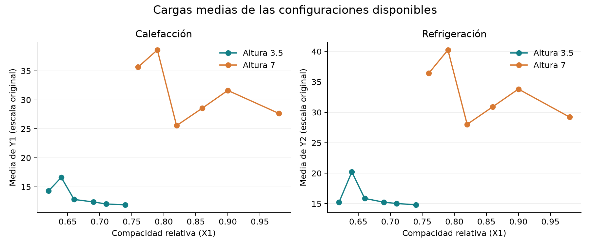
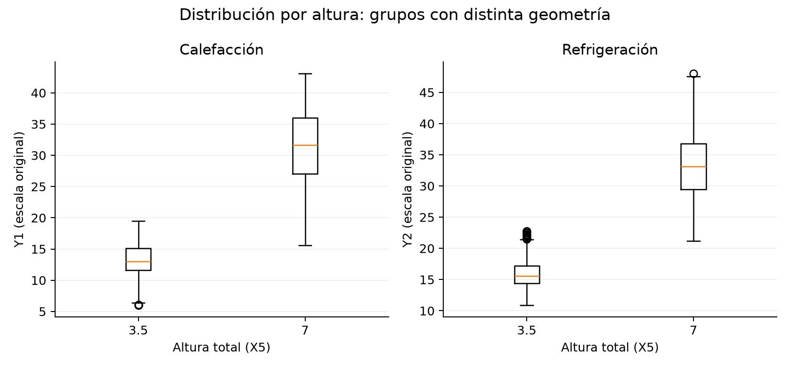
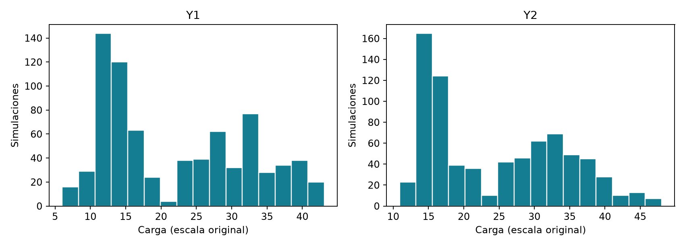

# Unidad II · Exploración y diagnóstico

Ulises González Coronado · Actualización técnica: 16 de noviembre de 2026

## Origen, estructura y variables

Pregunta: ¿cómo cambian las cargas de calefacción y refrigeración entre edificios con distinta compacidad relativa y altura total? Se analizan 768 simulaciones de 12 geometrías. Y1 e Y2 son cargas, no años. Los resultados usan la escala original porque la ficha consultada no declara las unidades.

Fuente: Tsanas, A. y Xifara, A. (2012). Energy Efficiency. UCI Machine Learning Repository. DOI: 10.24432/C51307. Licencia CC BY 4.0. El Excel original conserva su contenido.

Los datos son estructurados: un archivo Excel con diez columnas numéricas. X1-X5 y X7 representan características físicas; X6 y X8 son categorías nominales codificadas. Y1 y Y2 son las respuestas. Los notebooks muestran head, shape, columns, info, dtypes y describe. El diccionario completo está en docs/diccionario_datos.md y en el notebook de exploración.

| variable   |      mean |   median |   min |   max |       std |
|:-----------|----------:|---------:|------:|------:|----------:|
| X1         |  0.764167 |     0.75 |  0.62 |  0.98 |  0.105777 |
| Y1         | 22.3072   |    18.95 |  6.01 | 43.1  | 10.0902   |
| Y2         | 24.5878   |    22.08 | 10.9  | 48.03 |  9.51331  |

## Calidad y decisiones

No se encontraron valores faltantes, duplicados completos ni entradas X1-X8 repetidas. Los tipos son compatibles y los códigos pertenecen a los dominios observados. Se revisan atípicos mediante IQR; una marca estadística no basta para eliminar una simulación válida. Se conservan las 768 filas.

## Tres visualizaciones e interpretación

La relación entre compacidad y cargas cambia entre las configuraciones observadas. Ninguna compacidad aparece en ambas alturas; los efectos de ambas variables no se pueden aislar.

Las distribuciones por altura muestran mayor carga en el grupo de 7, que además presenta otras diferencias de geometría.

Los histogramas muestran un rango amplio de calefacción y refrigeración. El promedio resume las simulaciones, pero no describe por sí solo la heterogeneidad de los diseños.

## Propuesta de análisis y conclusión

Regresión: X1-X8 para predecir Y1/Y2. Clasificación: las mismas entradas para distinguir Y1 alta/baja con corte didáctico de 25. Clustering: X1-X5 y X7 estandarizadas, excluyendo objetivos y códigos nominales. El dataset es viable para practicar estos métodos, con límites de simulación y poca diversidad geométrica.
