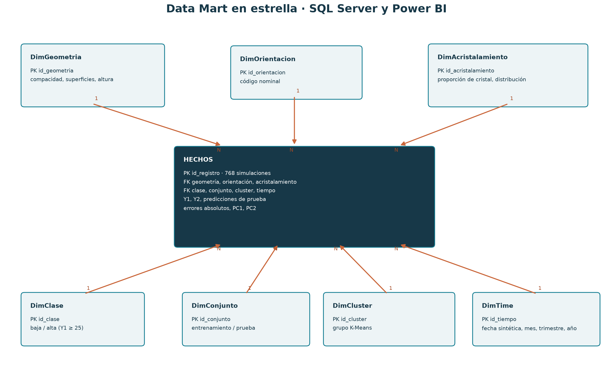

# Unidad II · ETL y Data Mart

Ulises González Coronado · Actualización técnica: 20 de noviembre de 2026

## Extracción y preparación

Pregunta: ¿cómo cambian las cargas de calefacción y refrigeración entre edificios con distinta compacidad relativa y altura total? Se analizan 768 simulaciones de 12 geometrías. Y1 e Y2 son cargas, no años. Los resultados usan la escala original porque la ficha consultada no declara las unidades.

El ETL lee el Excel en data/raw, crea una copia y valida columnas, tipos, dominios, duplicados, nulos y valores finitos. X6/X8 se conservan como enteros nominales. No hay imputaciones ni eliminaciones. Se agregan id_registro, grupo_geometria y clase_calefaccion; la clase es alta cuando Y1 >= 25. En los modelos se aplica OneHotEncoder a las categorías y escalamiento dentro del Pipeline.

| Control          |   Resultado |
|:-----------------|------------:|
| Filas originales |         768 |
| Filas procesadas |         768 |
| Faltantes        |           0 |
| Duplicados       |           0 |
| Imputaciones     |           0 |
| Eliminaciones    |           0 |

El SHA-256 del original es 0089fcffc1415e41e2ff63730cca5280efe54fc43d722dfde1b0aaa808e35dc4. Los valores X1-X8/Y1-Y2 se comparan directamente con el archivo procesado. Los derivados se guardan en data/processed.

## Modelo dimensional en estrella

Grano: una simulación por fila en HECHOS, con id_registro como llave primaria. La altura se integra en DimGeometria, la proporción/distribución de cristal en DimAcristalamiento y DimTime contiene un calendario sintético para el ETL temporal. HECHOS referencia directamente siete dimensiones: geometría, orientación, acristalamiento, clase, conjunto, cluster y tiempo. Las medidas Y1/Y2 se analizan con promedios; sumar cargas de escenarios alternativos no representa consumo real.

## Carga y validación en SQL Server

La base REC_ECBD_Energia contiene DatasetOriginal, HECHOS, dimensiones y tablas de evaluación. `sql/limpiar_datamart_full.sql` ejecuta DELETE en orden seguro y el ETL vuelve a cargar el Data Mart; el Job ECBD_Carga_FULL_Energia automatiza la misma secuencia. Los scripts afectan únicamente la base del proyecto y usan transacciones con XACT_ABORT y manejo de errores.

La vista vDatasetReconstruido vuelve a unir hechos y dimensiones. EXCEPT en ambos sentidos no encuentra diferencias respecto a DatasetOriginal. Se verifican 768 hechos, siete llaves foráneas directas a HECHOS y 231 predicciones. En entrenamiento las predicciones son NULL deliberadamente. Power BI importa estas mismas tablas y reproduce sus relaciones.
