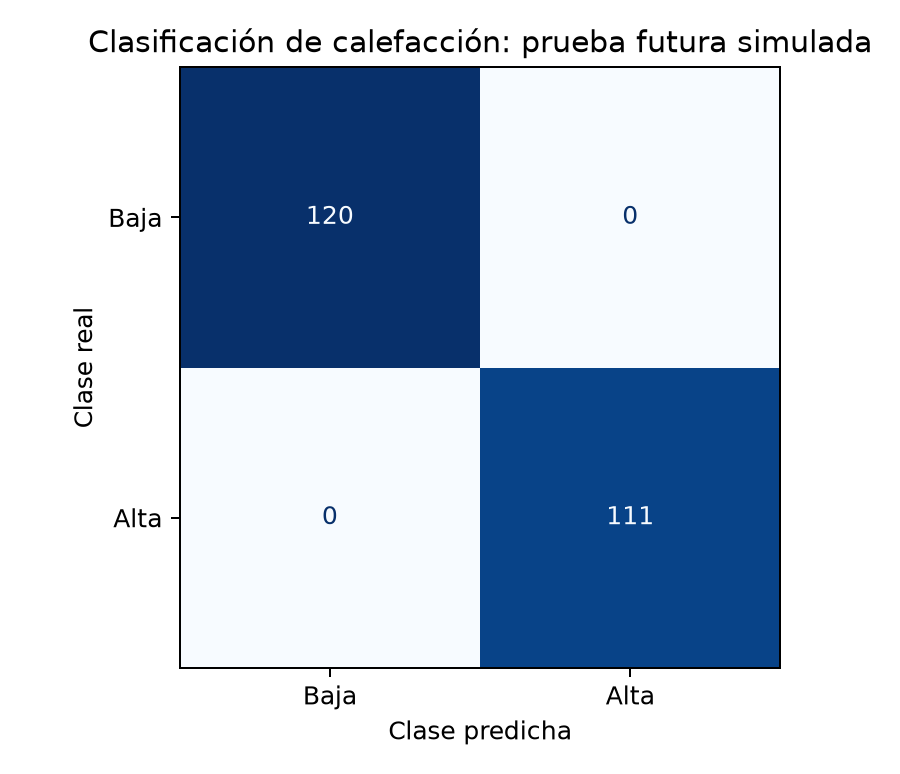
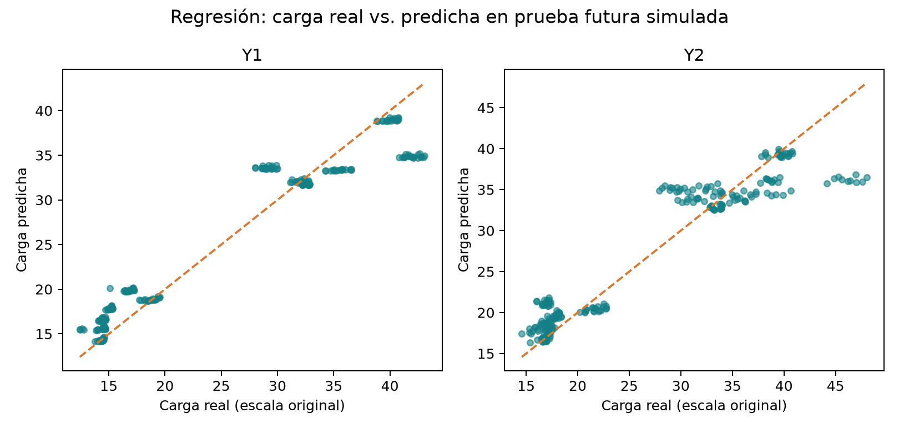

# Unidad III · Análisis supervisado

Ulises González Coronado · Actualización técnica: 20 de noviembre de 2026

## Diseño y prevención de fuga

Pregunta: ¿cómo cambian las cargas de calefacción y refrigeración entre edificios con distinta compacidad relativa y altura total? Se analizan 768 simulaciones de 12 geometrías. Y1 e Y2 son cargas, no años. Los resultados usan la escala original porque la ficha consultada no declara las unidades.

Las entradas son X1-X8. La regresión estima Y1/Y2; la clasificación usa alta si Y1 >= 25. El corte temporal usa el 70% inicial de una fecha sintética para entrenamiento (537 filas) y el 30% posterior para prueba futura simulada (231 filas). La fecha no existía en la fuente, por lo que este ejercicio demuestra el flujo y no prueba desempeño temporal real. El preprocesamiento se ajusta dentro de cada fold.

## Comparación y optimización justificada

GroupKFold de tres particiones dentro de entrenamiento compara Ridge con Random Forest y logística con Random Forest. Se prueban alpha, C, profundidad máxima y tamaño mínimo de hoja. Ridge con alpha 10 obtuvo el menor MAE de validación de los candidatos de regresión; logística con C=0.1 obtuvo el mayor F1 macro en clasificación. La prueba futura simulada no interviene en la selección.

| modelo           | objetivo   |     MAE |     RMSE |         R2 |
|:-----------------|:-----------|--------:|---------:|-----------:|
| Ridge            | Y1         | 2.20254 |  2.98524 |  0.918598  |
| Ridge            | Y2         | 2.33163 |  3.24753 |  0.890474  |
| Referencia_media | Y1         | 9.701   | 11.1841  | -0.142551  |
| Referencia_media | Y2         | 9.02163 | 10.214   | -0.0834379 |

El MAE es el error absoluto medio, RMSE penaliza errores grandes y R² compara con la dispersión de la prueba. Ridge mejora la referencia de predecir la media de entrenamiento en ambas cargas. Las métricas no prueban ahorro real.

## Clasificación y errores

| modelo             |   accuracy |   precision_macro |   recall_macro |   F1_macro |
|:-------------------|-----------:|------------------:|---------------:|-----------:|
| Logistica          |   1        |           1       |            1   |    1       |
| Referencia_mayoria |   0.519481 |           0.25974 |            0.5 |    0.34188 |

La logística acierta 231 de 231 casos: 120 cargas bajas y 111 altas en este corte temporal sintético. El resultado debe leerse con cautela porque la fecha fue generada para el ETL y las geometrías permanecen muy correlacionadas. Se presentan precisión, recall y F1 por clase en reporte_clasificacion.json; el promedio macro da el mismo peso a cada clase.

## Regresión, variables y utilidad

La importancia por permutación posterior a la selección identifica X5 como la variable con mayor deterioro al permutarla en ambas tareas. X4 y X7 también aportan señal. Algunas importancias son negativas: la correlación geométrica y la muestra pequeña pueden producir estos resultados. No se interpretan como efectos causales. Los detalles están en importancia_variables.csv.

La regresión permite comparar estimaciones entre diseños; la clasificación resume un umbral didáctico. Solo se evalúa un corte temporal construido con fechas sintéticas sobre 12 geometrías simuladas, por lo que falta validación externa antes de tomar decisiones reales.
