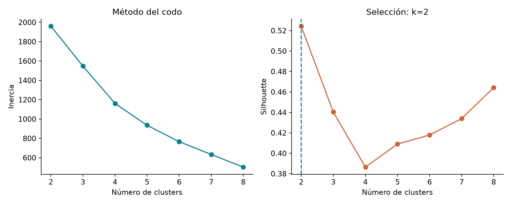
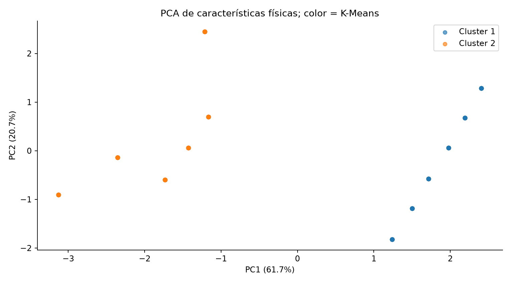
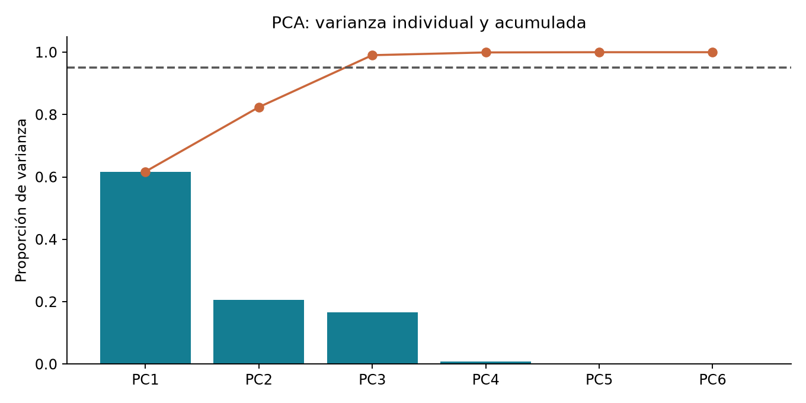

# Unidad IV · Análisis no supervisado

Ulises González Coronado · Actualización técnica: 16 de noviembre de 2026

## Variables y estandarización

Se usan X1, X2, X3, X4, X5 y X7 porque representan atributos físicos comparables mediante distancias después de StandardScaler. Se excluyen los códigos nominales X6/X8 y las cargas Y1/Y2. El análisis es exploratorio de las 768 simulaciones y no estima capacidad predictiva fuera de muestra.

## K-Means: elección del número de grupos

|   k |   inercia |   silhouette |
|----:|----------:|-------------:|
|   2 |  1961.23  |     0.52444  |
|   3 |  1547.5   |     0.44035  |
|   4 |  1161.53  |     0.386473 |
|   5 |   935.765 |     0.409069 |
|   6 |   765.952 |     0.417859 |
|   7 |   633.411 |     0.433899 |
|   8 |   502.789 |     0.46433  |

Se eligió k=2 por el mayor silhouette (0.5244) entre 2 y 8. Se usaron 30 inicializaciones y semilla 42. Silhouette mide separación y cohesión, no exactitud ni porcentaje de aciertos. Con semillas 7, 21 y 84, el ARI respecto a la solución principal fue 1.0.

## Perfil de los clusters

|   id_cluster |   registros |   altura_media |   compacidad_media |   calefaccion_media |   refrigeracion_media |
|-------------:|------------:|---------------:|-------------------:|--------------------:|----------------------:|
|            1 |         384 |            3.5 |           0.676667 |             13.3385 |               16.0714 |
|            2 |         384 |            7   |           0.851667 |             31.2759 |               33.1041 |

Los clusters coinciden con las dos alturas y sus geometrías asociadas. Cada grupo contiene 384 simulaciones. Ambos tienen la misma proporción media de cristal (0.234375). Las cargas se utilizan solo después para describir los grupos; no determinaron sus etiquetas. La geometría correlacionada domina el agrupamiento.

## PCA: representación y varianza

PC1 y PC2 retienen el 82.38% de la varianza estandarizada. Son combinaciones de variables originales, no nuevas unidades físicas. La proyección muestra separación de los grupos, pero pierde el 17.62% de la varianza. Las cargas de los componentes se incluyen en cargas_pca.csv.

| componente   |   varianza_explicada |   varianza_acumulada |
|:-------------|---------------------:|---------------------:|
| PC1          |          0.617157    |             0.617157 |
| PC2          |          0.206642    |             0.823798 |
| PC3          |          0.166667    |             0.990465 |
| PC4          |          0.00879231  |             0.999257 |
| PC5          |          0.000742585 |             1        |
| PC6          |          0           |             1        |

## Conocimiento y recomendaciones

Tres componentes conservan al menos el 95% de la varianza. El análisis permite organizar comparaciones entre diseños semejantes y reconocer que altura, compacidad y superficies no varían de forma independiente. Se recomienda comparar ambas cargas dentro de grupos geométricos y validar patrones con datos de edificios reales. Los clusters no certifican eficiencia; estabilidad de semillas tampoco equivale a validez externa.
