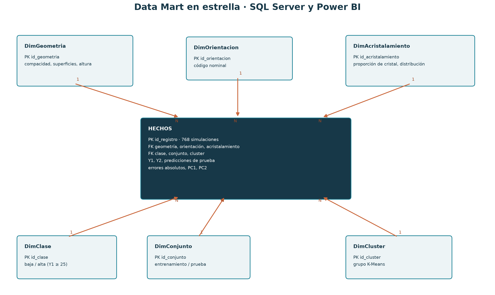
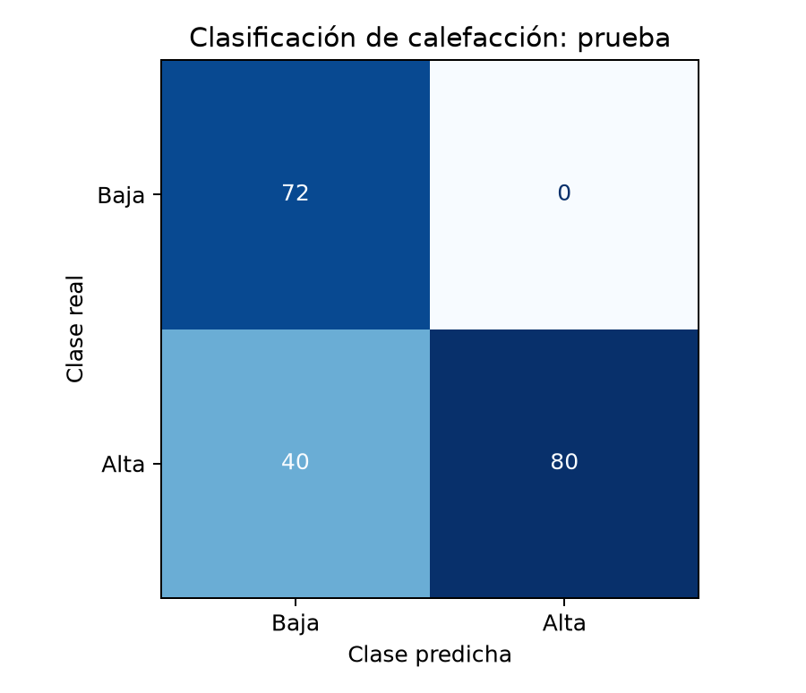
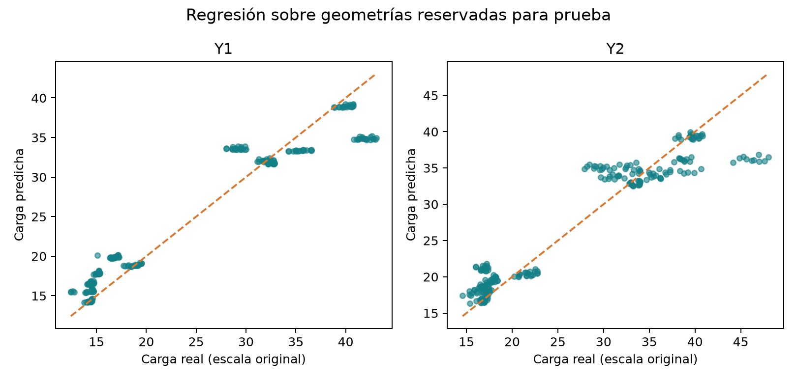
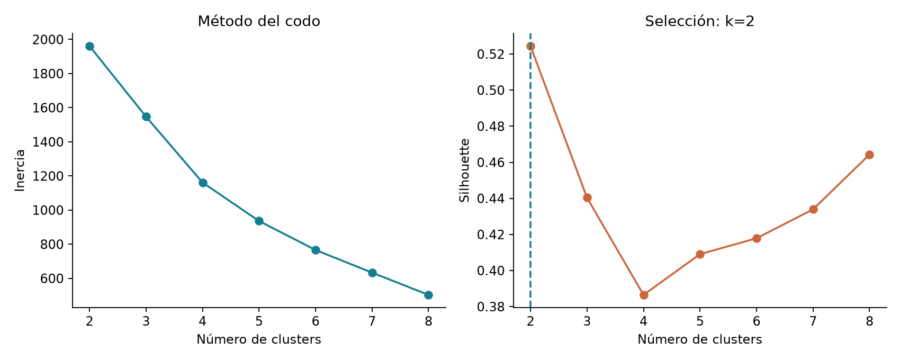
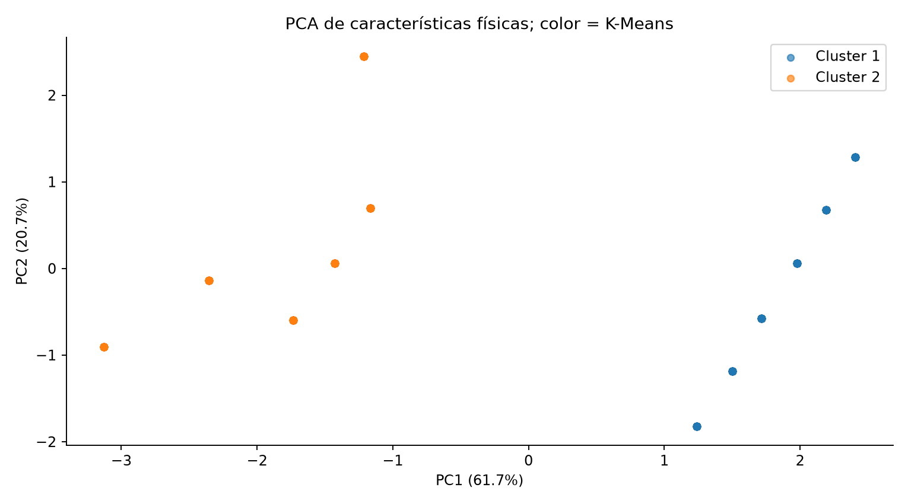
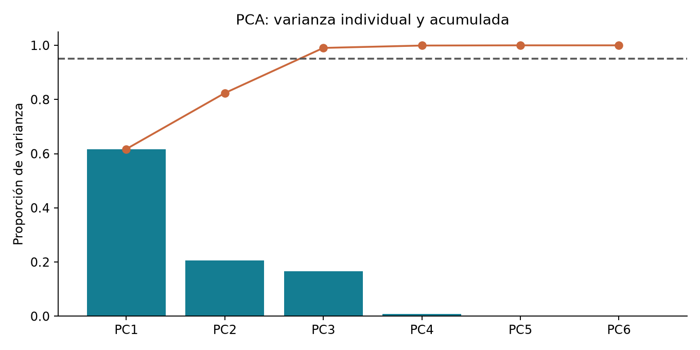

# Proyecto Integrador · Informe final

Ulises González Coronado · Actualización técnica: 16 de noviembre de 2026

## Resumen ejecutivo

Pregunta: ¿cómo cambian las cargas de calefacción y refrigeración entre edificios con distinta compacidad relativa y altura total? Se analizan 768 simulaciones de 12 geometrías. Y1 e Y2 son cargas, no años. Los resultados usan la escala original porque la ficha consultada no declara las unidades.

El proyecto integra exploración, preparación, SQL Server, un Data Mart en estrella, modelos supervisados, K-Means, PCA y un dashboard de cuatro páginas en Power BI. Se conserva el dataset original y el código permite reconstruir las evidencias.

## Tres conclusiones sustentadas

1. La calefacción media es 13.34 para altura 3.5 y 31.28 para altura 7; refrigeración media 16.07 y 33.10. Las geometrías también cambian, por lo que no puede aislarse causalmente la altura.

2. Random Forest obtiene MAE 3.3304 en calefacción y 4.3288 en refrigeración, inferiores a 8.2677 y 8.5548 de la referencia de la media. La logística logra 79.17% de exactitud y deja 40 cargas altas como bajas.

3. K-Means selecciona dos grupos de 384 casos, con silhouette 0.5244. Coinciden con alturas y geometrías distintas. PC1/PC2 explican 82.38% de la varianza; tres componentes superan el 95%.

## Recomendaciones de decisión

Comparar configuraciones dentro de geometrías semejantes y considerar simultáneamente calefacción y refrigeración. Revisar falsos negativos antes de usar la clasificación para descartar diseños. Incorporar clima, materiales y mediciones reales antes de extrapolar a construcción.

## Extracción y preparación

Pregunta: ¿cómo cambian las cargas de calefacción y refrigeración entre edificios con distinta compacidad relativa y altura total? Se analizan 768 simulaciones de 12 geometrías. Y1 e Y2 son cargas, no años. Los resultados usan la escala original porque la ficha consultada no declara las unidades.

El ETL lee el Excel en data/raw, crea una copia y valida columnas, tipos, dominios, duplicados, nulos y valores finitos. X6/X8 se conservan como enteros nominales. No hay imputaciones ni eliminaciones. Se agregan id_registro, grupo_geometria y clase_calefaccion; la clase es alta cuando Y1 >= 25. En los modelos se aplica OneHotEncoder a las categorías y escalamiento dentro del Pipeline.

| Control          |   Resultado |
|:-----------------|------------:|
| Filas originales |         768 |
| Filas procesadas |         768 |
| Faltantes        |           0 |
| Duplicados       |           0 |
| Imputaciones     |           0 |
| Eliminaciones    |           0 |

El SHA-256 del original es 0089fcffc1415e41e2ff63730cca5280efe54fc43d722dfde1b0aaa808e35dc4. Los valores X1-X8/Y1-Y2 se comparan directamente con el archivo procesado. Los derivados se guardan en data/processed.

## Modelo dimensional en estrella

Grano: una simulación por fila en HECHOS, con id_registro como llave primaria. La altura se integra en DimGeometria y la proporción/distribución de cristal se integran en DimAcristalamiento. HECHOS referencia directamente seis dimensiones: geometría, orientación, acristalamiento, clase, conjunto y cluster. Se implementan seis llaves foráneas. Las medidas Y1/Y2 se analizan con promedios; sumar cargas de escenarios alternativos no representa consumo real.

## Carga y validación en SQL Server

La base REC_ECBD_Energia contiene DatasetOriginal, HECHOS, dimensiones y tablas de evaluación. El script sql/datamart.sql crea la base si hace falta y reemplaza únicamente las tablas del proyecto en transacciones con XACT_ABORT y manejo de errores. No modifica otras bases. Se conserva evidencia de la carga real en docs/verificacion_sqlserver.json.

La vista vDatasetReconstruido vuelve a unir hechos y dimensiones. EXCEPT en ambos sentidos no encuentra diferencias respecto a DatasetOriginal. Se verifican 768 hechos, seis llaves foráneas directas a HECHOS y 192 predicciones. En entrenamiento las predicciones son NULL deliberadamente. Power BI importa estas mismas tablas y reproduce sus relaciones.

## Diseño y prevención de fuga

Pregunta: ¿cómo cambian las cargas de calefacción y refrigeración entre edificios con distinta compacidad relativa y altura total? Se analizan 768 simulaciones de 12 geometrías. Y1 e Y2 son cargas, no años. Los resultados usan la escala original porque la ficha consultada no declara las unidades.

Las entradas son X1-X8. La regresión estima Y1/Y2; la clasificación usa alta si Y1 >= 25. El corte se fija antes de entrenar y no es una norma energética. GroupShuffleSplit reserva tres geometrías completas: 576 filas de entrenamiento y 192 de prueba, sin geometrías compartidas. El preprocesamiento se ajusta dentro de cada fold.

## Comparación y optimización justificada

GroupKFold de tres particiones compara Ridge con Random Forest y logística con Random Forest. Se prueban alpha, C, profundidad máxima y tamaño mínimo de hoja. En validación, el MAE conjunto del bosque con profundidad 8 y hoja 1 es 3.5896, frente a 3.5935 sin límite de profundidad. Se elige la opción ligeramente más simple. En logística, C=1 mejora F1 macro de validación de 0.8413 (C=0.1) a 0.8847; C=10 baja a 0.8500. La prueba no interviene en la elección.

| modelo           | objetivo   |     MAE |    RMSE |        R2 |
|:-----------------|:-----------|--------:|--------:|----------:|
| RandomForest     | Y1         | 3.33042 | 3.61722 |  0.806371 |
| RandomForest     | Y2         | 4.32878 | 4.7784  |  0.695788 |
| Referencia_media | Y1         | 8.26768 | 8.87769 | -0.166332 |
| Referencia_media | Y2         | 8.55478 | 9.09301 | -0.101609 |

El MAE es el error absoluto medio, RMSE penaliza errores grandes y R² compara con la dispersión de la prueba. El bosque mejora la referencia de predecir la media de entrenamiento en ambas cargas. Las métricas no prueban ahorro real.

## Clasificación y errores

| modelo             |   accuracy |   precision_macro |   recall_macro |   F1_macro |
|:-------------------|-----------:|------------------:|---------------:|-----------:|
| Logistica          |   0.791667 |          0.821429 |       0.833333 |   0.791304 |
| Referencia_mayoria |   0.375    |          0.1875   |       0.5      |   0.272727 |

La logística acierta 152 de 192 casos. Reconoce las 72 cargas bajas y 80 de las 120 altas. Los 40 falsos negativos de carga alta limitan su uso para descartar diseños. Se presentan precisión, recall y F1 por clase en reporte_clasificacion.json; el promedio macro da el mismo peso a cada clase.

## Regresión, variables y utilidad

La importancia por permutación posterior a la selección identifica X5 como la variable con mayor deterioro al permutarla en ambas tareas. X4 y X7 también aportan señal. Algunas importancias son negativas: la correlación geométrica y la muestra pequeña pueden producir estos resultados. No se interpretan como efectos causales. Los detalles están en importancia_variables.csv.

La regresión permite comparar estimaciones entre diseños; la clasificación resume un umbral didáctico. Solo se evalúa una separación de 12 geometrías simuladas, por lo que falta validación externa antes de tomar decisiones reales.

## Variables y estandarización

Se usan X1, X2, X3, X4, X5 y X7 porque representan atributos físicos comparables mediante distancias después de StandardScaler. Se excluyen los códigos nominales X6/X8 y las cargas Y1/Y2. El análisis es exploratorio de las 768 simulaciones y no estima capacidad predictiva fuera de muestra.

## K-Means: elección del número de grupos

|   k |   inercia |   silhouette |
|----:|----------:|-------------:|
|   2 |  1961.23  |     0.52444  |
|   3 |  1547.5   |     0.44035  |
|   4 |  1161.53  |     0.386473 |
|   5 |   935.765 |     0.409069 |
|   6 |   765.952 |     0.417859 |
|   7 |   633.411 |     0.433899 |
|   8 |   502.789 |     0.46433  |

Se eligió k=2 por el mayor silhouette (0.5244) entre 2 y 8. Se usaron 30 inicializaciones y semilla 42. Silhouette mide separación y cohesión, no exactitud ni porcentaje de aciertos. Con semillas 7, 21 y 84, el ARI respecto a la solución principal fue 1.0.

## Perfil de los clusters

|   id_cluster |   registros |   altura_media |   compacidad_media |   calefaccion_media |   refrigeracion_media |
|-------------:|------------:|---------------:|-------------------:|--------------------:|----------------------:|
|            1 |         384 |            3.5 |           0.676667 |             13.3385 |               16.0714 |
|            2 |         384 |            7   |           0.851667 |             31.2759 |               33.1041 |

Los clusters coinciden con las dos alturas y sus geometrías asociadas. Cada grupo contiene 384 simulaciones. Ambos tienen la misma proporción media de cristal (0.234375). Las cargas se utilizan solo después para describir los grupos; no determinaron sus etiquetas. La geometría correlacionada domina el agrupamiento.

## PCA: representación y varianza

PC1 y PC2 retienen el 82.38% de la varianza estandarizada. Son combinaciones de variables originales, no nuevas unidades físicas. La proyección muestra separación de los grupos, pero pierde el 17.62% de la varianza. Las cargas de los componentes se incluyen en cargas_pca.csv.

| componente   |   varianza_explicada |   varianza_acumulada |
|:-------------|---------------------:|---------------------:|
| PC1          |          0.617157    |             0.617157 |
| PC2          |          0.206642    |             0.823798 |
| PC3          |          0.166667    |             0.990465 |
| PC4          |          0.00879231  |             0.999257 |
| PC5          |          0.000742585 |             1        |
| PC6          |          0           |             1        |

## Conocimiento y recomendaciones

Tres componentes conservan al menos el 95% de la varianza. El análisis permite organizar comparaciones entre diseños semejantes y reconocer que altura, compacidad y superficies no varían de forma independiente. Se recomienda comparar ambas cargas dentro de grupos geométricos y validar patrones con datos de edificios reales. Los clusters no certifican eficiencia; estabilidad de semillas tampoco equivale a validez externa.

## Dashboard y storytelling

Abrir dashboard/Energia.pbip (proyecto editable) o el PBIX guardado, y actualizar desde SQL Server. Página 1: problema y datos, indicadores, altura, compacidad y cristal. Página 2: predicciones, métricas y matriz de confusión. Página 3: elección de k, perfiles, PCA y varianza. Página 4: ETL, estrella, conclusiones y recomendaciones. La Vista de modelo permite inspeccionar las relaciones reales.

## Reproducibilidad y defensa

Instalar requirements_notebooks.txt, ejecutar python -m src.ejecutar_proyecto, después python -m src.etl_sqlserver --cargar y ejecutar todos los notebooks. Las evidencias automáticas están en docs/verificacion_sqlserver.json y docs/verificacion_notebooks.json. El guion de defensa explica el orden y las decisiones. No se acredita una defensa oral ni observaciones futuras por generar estos archivos.

## Calendario y observaciones

Los dos documentos recibidos difieren: el programa de trabajo continuo fija revisión formal el 17 de noviembre, mientras el programa de actividades restantes indica revisión integradora el 18. Ambos fijan cierre el 20 de noviembre de 2026. Se conserva esa diferencia en la matriz de cumplimiento. Las observaciones del docente se registrarán cuando ocurran y deberán resolverse antes del cierre.

## Fuentes

Fuente: Tsanas, A. y Xifara, A. (2012). Energy Efficiency. UCI Machine Learning Repository. DOI: 10.24432/C51307. Licencia CC BY 4.0. El Excel original conserva su contenido.

Scikit-learn: documentación de GroupKFold, GridSearchCV, KMeans, silhouette_score y PCA, https://scikit-learn.org/stable/. Microsoft Learn: proyectos Power BI, https://learn.microsoft.com/power-bi/developer/projects/projects-overview. Los requisitos académicos proceden de los dos programas proporcionados por el estudiante. Repositorio: https://github.com/UlisesGC26/REC_ECBD_2026_Gonzalez_Ulises.
