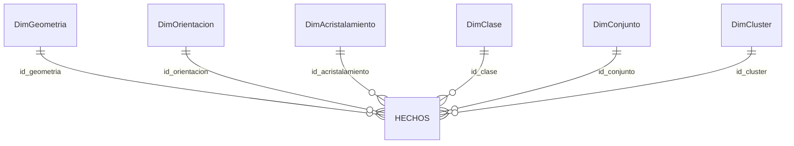

# ETL y Data Mart final: modelo estrella

La base final es **REC_ECBD_Energia**, en SQL Server. `src/etl_sqlserver.py` genera el esquema en estrella y la carga autocontenida `sql/datamart.sql`. `DatasetOriginal` conserva las diez variables y un identificador por fila; el Excel no se modifica.

## Flujo ETL

1. Extraer el Excel con Pandas y comprobar su SHA-256.
2. Validar columnas, tipos, valores finitos, categorías, faltantes y duplicados.
3. Conservar las 768 filas; no existen motivos documentados para imputar o eliminar registros.
4. Generar resultados supervisados y no supervisados: predicciones solo para prueba, cluster y componentes PCA.
5. Construir dimensiones desnormalizadas, asignar llaves y cargar SQL Server dentro de una transacción.
6. Validar conteos, llaves y reconstrucción exacta del dataset original con `EXCEPT` en ambos sentidos.
7. Importar las tablas en Power BI y reproducir las relaciones 1:N, desde dimensiones hacia HECHOS.

## Relaciones del modelo estrella

El grano de `HECHOS` es una simulación por `id_registro`. Contiene Y1/Y2, predicciones, errores absolutos y PC1/PC2. Las 576 filas de entrenamiento tienen predicciones `NULL` por diseño; las 192 de prueba sí tienen predicción.

Para mantener una estrella real, `DimGeometria` incluye altura junto con compacidad y superficies. `DimAcristalamiento` incluye proporción de cristal y código de distribución. Así, las seis dimensiones se relacionan directamente con `HECHOS`, sin relaciones entre dimensiones. Los códigos X6/X8 se conservan sin inventar etiquetas cardinales.

Las cargas son medidas no aditivas entre escenarios alternativos y se presentan como promedios. Las tablas de métricas son auxiliares, con grano propio por algoritmo/objetivo o componente, y no se mezclan con HECHOS.

La carga es idempotente: reconstruye únicamente las tablas del proyecto. Además elimina las tres dimensiones normalizadas que pertenecían al diseño anterior para impedir un modelo mixto. `SET XACT_ABORT ON` y `TRY/CATCH` revierten cambios ante fallos. La evidencia de ejecución está en `docs/verificacion_sqlserver.json`.

El esquema vigente y la defensa utilizan `sql/datamart.sql`, `docs/diagrama_estrella.svg` y `docs/modelo_estrella.json`.
