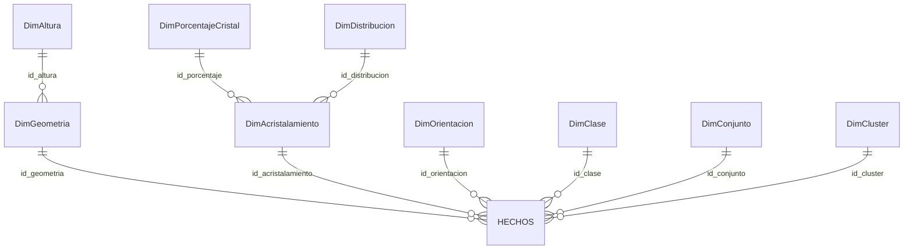

# ETL y Data Mart final

La base final es **REC_ECBD_Energia**, en SQL Server. `src/etl_sqlserver.py` genera el esquema y la carga autocontenida `sql/datamart.sql`. `DatasetOriginal` conserva las diez variables y un identificador por fila. El archivo Excel no se modifica.

## Flujo

1. Extraer Excel con Pandas y verificar SHA-256.
2. Validar columnas, tipos, valores finitos, categorías, faltantes y duplicados.
3. Conservar 768 filas: no hay motivos para imputar o eliminar. Crear identificadores, grupo de geometría y clase alta/baja.
4. Generar modelos y resultados: predicciones exclusivamente de prueba, cluster y componentes PCA.
5. Normalizar dimensiones, asignar llaves y cargar SQL Server dentro de una transacción.
6. Validar llaves, conteos y reconstrucción exacta del dataset original mediante EXCEPT en ambos sentidos.
7. Importar las tablas a Power BI; reproducir relaciones 1:N, con filtro del lado 1 al lado N.

## Relaciones

El grano de HECHOS es una simulación por `id_registro`. Contiene Y1/Y2, predicciones, errores absolutos y PC1/PC2. Las predicciones de las 576 filas de entrenamiento son NULL por diseño; las 192 filas de prueba sí tienen predicción. Esto evita presentar evaluación de entrenamiento como prueba.

Las cargas son medidas no aditivas entre escenarios alternativos: se muestran medias. DimGeometria separa altura y DimAcristalamiento separa proporción y distribución; esto convierte el esquema en copo de nieve. Los códigos X6/X8 se conservan sin inventar etiquetas cardinales. Las tablas de métricas son auxiliares, con grano propio por algoritmo/objetivo o componente; no se mezclan con HECHOS.

La carga es idempotente: reconstruye únicamente las tablas dedicadas de la base del proyecto. `SET XACT_ABORT ON` y TRY/CATCH revierten cambios ante fallos. `sql/validar_datamart.sql` comprueba el resultado. La evidencia de ejecución real está en `verificacion_sqlserver.json`.

El SQLite y los scripts antiguos se conservan como antecedente. El esquema final y la defensa utilizan `sql/datamart.sql` y `diagrama_copo_nieve.svg`.
